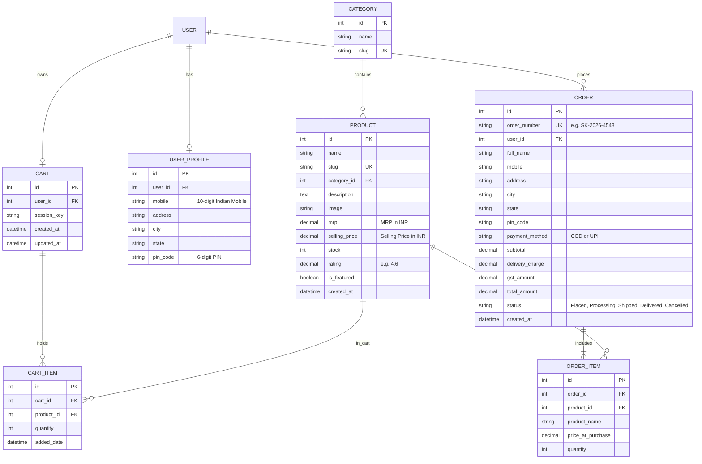

# 🇮🇳 ShopKart India - Simple E-Commerce Web Application

> **CodeAlpha Full Stack Development Internship Project Submission**  
> A production-ready, full-stack Indian e-commerce web platform built strictly with **Django (Python)**, **SQLite**, and **Vanilla HTML5, CSS3, & JavaScript** (no frontend frameworks, no Bootstrap, Tailwind, or React).

---

## 📌 Project Overview

**ShopKart India** is an Indian online shopping website where customers can browse Indian products across diverse categories, filter and search for items, inspect specifications, manage a shopping cart, register and log in securely, and complete orders with Cash on Delivery (COD) or mock UPI payments.

All product prices, delivery charges, GST calculations, and order subtotals are displayed in **Indian Rupees (₹)** formatted according to the **Indian numbering convention** (e.g. `₹1,299`, `₹1,49,999`).

---

## 🌟 Key Features

### 1. 🛍️ Home & Product Listings Page
- **Indian E-Commerce Theme**: Clean, trustworthy Flipkart/Amazon-inspired blue (`#2874f0`), saffron/orange (`#fb641b` / `#ff9f00`), and emerald green (`#388e3c`) color scheme.
- **Top Header**: Logo with "Explore Plus ★" tagline, live product search bar, user dropdown, seller portal link, and cart badge with live item count.
- **Category Navigation Strip**: Instant filtering across **6 Indian Categories**:
  - 📱 *Electronics* (Earbuds, Power Banks, Chargers)
  - 👗 *Fashion* (Cotton Handloom Kurtas, Kanjivaram Silk Sarees)
  - 🍳 *Home & Kitchen* (Insulated Bottles, Cast Iron Dosa Tawas, Copper Matkas)
  - 🌿 *Beauty* (Ayurvedic Kumkumadi Face Creams, Bhringraj & Amla Hair Oils)
  - 📚 *Books* (Python Programming Indian Edition, Wings of Fire by Dr. A.P.J. Abdul Kalam)
  - 🌾 *Grocery* (Traditional Basmati Rice, Tata Tea Gold, Kachi Ghani Mustard Oil, Kashmiri Kesar)
- **Product Cards**: High-res image, product name, category tag, rating badge (`★ 4.6`), Indian Rupee selling price, crossed-out MRP, discount percentage badge (`Save 53% off`), free delivery tag, stock status badge (`In Stock`, `Only X left!`, `Out of Stock`), and quick "Add to Cart" button.
- **Sorting Options**: Sort by Popularity, Price (Low to High), Price (High to Low), Customer Rating, and Newest First.
- **Pagination**: Clean, accessible pagination controls.

### 2. 🔍 Product Details Page
- High-definition image preview with fallback SVG placeholders.
- MRP, selling price in ₹, exact rupees saved, and special festive offer badges.
- **Bank & Partner Offers**: 5% cashback on cards, special discounts on UPI, and free delivery perks.
- Interactive **Quantity Stepper** (`-` / input / `+`) bounded by inventory.
- Real-time stock status indicator.
- Prominent **ADD TO CART** (yellow-orange) and **BUY NOW** (orange) buttons. Clicking *Buy Now* adds the product to cart and directly redirects to checkout!
- Customer confidence trust badges (7 Days Replacement, Brand Warranty, Cash on Delivery).
- Related products grid from the same category.

### 3. 🛒 Shopping Cart Page
- Dynamic item management: increase, decrease, or remove items.
- Free delivery progress indicator: *"Add ₹X more to get FREE Delivery!"*.
- **Indian Delivery Rules**: Orders above **₹999** get **FREE Delivery**; orders below ₹999 incur a flat **₹49** delivery fee.
- **GST Calculation**: Displays 18% GST calculation line item.
- Real-time Order Summary box showing Items Subtotal, Total Savings on MRP, Delivery Fee, GST, and Total Payable.
- Database and session persistence for guests and logged-in customers.
- Empty cart state with a direct "Shop Now" call to action.

### 4. 🔐 User Authentication & Security
- **Registration**: Full Name, Email, **10-Digit Indian Mobile Number** (`^[6-9]\d{9}$`), Password, and Password Confirmation.
- **Login**: Flexible sign-in using either registered Email, Username, or 10-digit Mobile Number.
- **Password Security**: Built-in Django PBKDF2 with SHA-256 password hashing.
- **Route Protection**: Checkout, Order History, and Admin Dashboard protected with `@login_required` and staff permission decorators.
- **CSRF Protection**: Native CSRF tokens implemented across all forms and asynchronous requests.

### 5. 📦 Checkout & Order Processing
- **Indian Delivery Address Collection**:
  - Recipient Full Name
  - 10-Digit Mobile Number
  - Street / Building Address
  - City / Town
  - State (Dropdown of all 36 Indian States & Union Territories)
  - 6-Digit Indian Postal PIN Code (`^[1-9][0-9]{5}$`)
- **Payment Methods**:
  - Cash on Delivery (COD)
  - UPI (Google Pay, PhonePe, Paytm, BHIM mock sandbox)
- **Stock Validation**: Concurrency-safe atomic transaction (`transaction.atomic`) preventing overselling.
- **Unique Order IDs**: Formatted as `SK-2026-XXXX`.
- **Order Confirmation Page**: Detailed receipt with Order ID, customer details, estimated delivery date (3-4 business days), and itemized pricing.
- **My Orders Page**: Order history tracking with item thumbnails, status badges (`Placed`, `Processing`, `Shipped`, `Delivered`, `Cancelled`), and address details.

### 6. 📊 Store Administration & Seller Hub
- **Custom Admin Dashboard** (`/admin-dashboard/`):
  - KPI metric cards: Total Products, Total Orders, Gross Revenue in ₹, Registered Customers.
  - Low-stock inventory alert banner highlighting items with &le; 5 units remaining.
  - Complete product catalog table with live **Add New Product**, **Edit Product**, and **Delete Product** actions.
  - Recent customer orders table with order IDs, locations, and values in ₹.
- **Django Admin** (`/admin/`): Registered with Category, Product, Order (with inline items), UserProfile, and Cart models.

---

## 🗄️ Database Architecture

The SQLite database (`db.sqlite3`) implements the following relational schema:



---

## 📂 Project Directory Structure

```text
codealpha/
├── ecommerce/                   # Django project configuration
│   ├── __init__.py
│   ├── settings.py              # Environment variables, timezone (Asia/Kolkata), apps
│   ├── urls.py                  # Root URL dispatcher
│   ├── wsgi.py
│   └── asgi.py
├── store/                       # Core e-commerce application
│   ├── __init__.py
│   ├── admin.py                 # Django admin registration
│   ├── apps.py                  # Store application configuration
│   ├── models.py                # Category, Product, UserProfile, Cart, CartItem, Order, OrderItem
│   ├── views.py                 # Catalog, cart, buy now, checkout, auth, and admin views
│   ├── urls.py                  # Store routing patterns
│   ├── forms.py                 # Registration, login, checkout, and product forms
│   ├── cart.py                  # Database and session cart business logic
│   ├── context_processors.py    # Global context variables (categories, cart badge)
│   ├── tests.py                 # Automated unit and integration test suite (9 test cases)
│   ├── templatetags/            # Custom Django template tags
│   │   ├── __init__.py
│   │   └── currency_tags.py     # Indian Rupee (₹) formatting and rating star filters
│   └── management/              # Custom management commands
│       └── commands/
│           ├── __init__.py
│           └── seed_data.py     # Seed 15 Indian products across 6 categories
├── static/                      # Static assets
│   ├── css/
│   │   └── styles.css           # Flipkart/Amazon-inspired Indian e-commerce Vanilla CSS
│   ├── js/
│   │   ├── main.js              # Dropdown toggles, toast notifications, guest cart sync
│   │   └── cart.js              # Quantity steppers & AJAX cart interactions
│   └── images/
│       └── placeholder.svg      # Resilient SVG fallback image
├── templates/                   # HTML5 Django templates
│   ├── base.html                # Master layout (header, nav, trust bar, footer)
│   ├── store/
│   │   ├── product_list.html    # Product grid, search, categories, pagination
│   │   ├── product_detail.html  # Product details, MRP, discount %, Add to Cart, Buy Now
│   │   ├── cart.html            # Shopping cart, delivery rules, order summary
│   │   ├── checkout.html        # Checkout & Indian address collection
│   │   ├── order_confirmation.html # Receipt with SK-2026-XXXX order ID
│   │   ├── my_orders.html       # Customer order history
│   │   ├── order_detail.html    # Order item breakdown
│   │   ├── admin_dashboard.html # Seller hub analytics & product CRUD table
│   │   └── admin_product_form.html # Add/edit product form
│   └── auth/
│       ├── login.html           # Customer login
│       └── register.html        # Registration with 10-digit mobile number
├── .env.example                 # Sample environment variables file
├── .gitignore                   # Standard Python/Django gitignore
├── seed.py                      # Standalone database seeder runner
├── run_website.bat              # One-click Windows website launcher
├── run_website.sh               # One-click Linux/macOS website launcher
├── requirements.txt             # Python project dependencies
├── db.sqlite3                   # SQLite database
├── manage.py                    # Django CLI entrypoint
└── README.md                    # Comprehensive documentation
```

---

## ⚡ Quick Start (1-Click Run)

### On Windows
Simply double-click **`run_website.bat`** (or run `.\run_website.bat` in Command Prompt / PowerShell).
It will automatically verify Python, install dependencies, run migrations, seed initial data, launch your browser, and start the development server at **http://127.0.0.1:8000/**.

### On Linux / macOS
```bash
chmod +x run_website.sh
./run_website.sh
```

---

## 🚀 Manual Installation & Setup Guide

### 1. Clone the Repository
```bash
git clone https://github.com/msnaren/code-alpha.git
cd code-alpha
```

### 2. Prerequisites
- Python 3.10+ (Verified on Python 3.11)
- Pip package manager

### 3. Install Dependencies
Open your terminal in the project directory and run:
```bash
pip install -r requirements.txt
```

### 4. Run Database Migrations
```bash
python manage.py migrate
```

### 5. Seed Demo Indian Products & Users
Run the database seed script to insert categories, 15 realistic Indian products, superuser admin, and demo customer:
```bash
python manage.py seed_data
```
*(Or use the standalone runner: `python seed.py`)*

### 5. Start the Development Server
```bash
python manage.py runserver
```
Visit **[http://127.0.0.1:8000/](http://127.0.0.1:8000/)** in your web browser.

---

## 🔑 Demo Credentials

| User Type | Username | Email / Identifier | Password | Access Privileges |
| :--- | :--- | :--- | :--- | :--- |
| **Superuser Admin** | `admin` | `admin@shopkart.in` | `Admin@123` | Store Dashboard (`/admin-dashboard/`) & Django Admin (`/admin/`) |
| **Demo Customer** | `rahul` | `rahul.sharma@example.com` or `9876543210` | `Password@123` | Browsing, cart, Buy Now, checkout, and [My Orders](http://127.0.0.1:8000/orders/) |

---

## 🧪 Running Automated Tests

Run the included automated test suite (catalog search, category filtering, cart calculations, stock deduction, and mobile number validation):

```bash
python manage.py test
```

Expected result:
```text
Creating test database for alias 'default'...
.........
----------------------------------------------------------------------
Ran 9 tests in 4.064s

OK
Destroying test database for alias 'default'...
```

---

## 🌐 Complete Route Map

| Endpoint | View Name | Description |
| :--- | :--- | :--- |
| `/` | `product_list` | Homepage with hero trust bar, category filter, and paginated product grid |
| `/product/<id>/` | `product_detail` | Detailed specifications, MRP, discount %, quantity selector, related items |
| `/cart/` | `cart_view` | Shopping cart review and order totals breakdown |
| `/cart/add/<id>/` | `cart_add` | Add product to cart (POST / AJAX) |
| `/buy-now/<id>/` | `buy_now` | Fast-track purchase: adds to cart and redirects straight to checkout |
| `/cart/decrease/<id>/` | `cart_decrease` | Decrease quantity by 1 |
| `/cart/remove/<id>/` | `cart_remove` | Remove item completely |
| `/cart/clear/` | `cart_clear` | Empty cart |
| `/cart/api/data/` | `cart_api_data` | JSON endpoint for frontend syncing |
| `/register/` | `register` | Customer account registration with 10-digit mobile number |
| `/login/` | `login` | Customer login using Email, Username, or Mobile |
| `/logout/` | `logout` | Sign out |
| `/checkout/` | `checkout` | Indian delivery address form & COD/UPI options (`@login_required`) |
| `/order/confirmation/<id>/` | `order_confirmation` | Order receipt with `SK-2026-XXXX` order ID |
| `/orders/` | `my_orders` | Customer order history with tracking status |
| `/orders/<id>/` | `order_detail` | Detailed breakdown of a specific past order |
| `/admin-dashboard/` | `admin_dashboard` | Seller Hub with metrics in ₹, low stock warnings, and product table |
| `/admin-dashboard/product/add/` | `admin_product_create` | Add new catalog product |
| `/admin-dashboard/product/<id>/edit/` | `admin_product_edit` | Edit catalog product |
| `/admin-dashboard/product/<id>/delete/` | `admin_product_delete` | Delete catalog product |
| `/admin/` | `admin:index` | Standard Django Admin panel |

---

## 💡 CodeAlpha Internship Submission Highlights
- **100% Vanilla Code**: Handcrafted CSS3 and Vanilla JS without Bootstrap, Tailwind, or React overhead.
- **Authentic Indian Localization**: Indian Rupees (`₹`), Indian numbering formatting (`₹1,299`), 10-digit phone verification, 6-digit Indian PIN codes, Indian states dropdown, and COD/UPI payment modes.
- **Production-Ready Clean Architecture**: Reusable templates, clean MVC organization, atomic database transactions, session-to-database cart merging, and automated test coverage.
